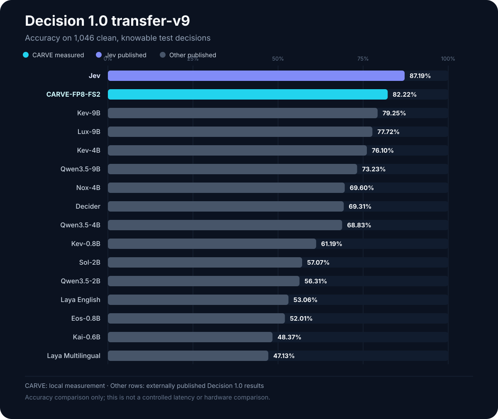
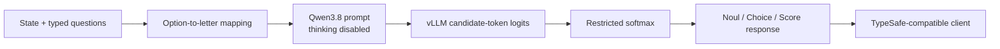

<p align="center">
  
</p>

<p align="center">
  <a href="https://github.com/rudransh2004/carve/actions/workflows/ci.yml"></a>
  
  
  
  
  
</p>

<p align="center">
  <a href="#quickstart">Quickstart</a> ·
  <a href="#decision-10-comparison">Benchmarks</a> ·
  <a href="#architecture">Architecture</a> ·
  <a href="docs/api.md">API</a> ·
  <a href="docs/model-card.md">Model card</a> ·
  <a href="docs/reproducibility.md">Reproduce</a>
</p>

# CARVE: Open-Source Jev-Style Decision Model

**Candidate-Aligned Readout via Vocabulary Evidence**

CARVE is an Apache-2.0, open-source Jev-style/System One decision model built
on Qwen3.8-27B. It scores only candidate letters assigned to user-defined
options and returns typed Noul, Choice, or Score answers through a
TypeSafe-compatible API. It makes each decision with one output token—without
generating free-form JSON and parsing it afterward.

“Jev-style” describes the typed decision interface and task category. CARVE is
an independent project and is not affiliated with or endorsed by TypeSafe AI.

> CARVE probabilities are **raw restricted candidate-token preferences**.
> They are not calibrated probabilities of correctness and must not be used as
> calibrated confidence scores.

## Why CARVE?

- **One-token decisions:** no free-form response generation or JSON parsing.
- **Typed outputs:** Noul, Choice, and Score responses through a familiar
  System One contract.
- **Reproducible evidence:** public protocols, frozen revisions, raw summaries,
  ablations, and negative results live beside the code.
- **Honest semantics:** every response identifies its probability level instead
  of presenting raw softmax as calibrated confidence.

## Measured results

### Decision 1.0 comparison

<p align="center">
  
</p>

CARVE ranks second in this published comparison: **82.22%**, behind Jev at
**87.19%** and ahead of Kev-9B at **79.25%**. CARVE was measured locally;
competitor values are externally published results from the
[Decision 1.0 evaluation](https://huggingface.co/llm-semantic-router/Decision-1.0-Lux-9B/blob/main/EVALUATION.md).
See the [chart data](artifacts/decision1-model-comparison.json) and
[reproduction protocol](docs/reproducibility.md). This is an accuracy
comparison on the same named protocol, not a controlled hardware or latency
comparison.

**Decision quality**

- **82.22%** (860/1,046) on the public Decision 1.0 transfer-v9 clean,
  knowable test decisions.
- Selected configuration: official `Qwen/Qwen3.8-27B-FP8`, two frozen
  task-family demonstrations, baseline prompt, one output token.
- Jev's published score is **87.19%** on the same named transfer benchmark.
  CARVE remains 4.97 points lower.

**Warm serial latency**

- **72.5 ms p50**, **91.0 ms p95**, 13.35 requests/s.
- Measured locally on one NVIDIA RTX PRO 6000 Blackwell Server Edition.

**Sustained load**

- **20.23 requests/s** across 2,048 shuffled requests at concurrency 8.
- 382.3 ms p50, 554.4 ms p95, and zero failures.
- The load sweep plus sustained run covered 5,120 requests with zero observed
  HTTP or response-validation failures.

These are local measurements, not a controlled hardware-to-hardware comparison
with Jev. See [the model card](docs/model-card.md) and
[benchmark methodology](docs/reproducibility.md).

## Architecture



For each question CARVE requests exactly one token plus logits for every
candidate letter, normalizes only those candidate logits, and maps the winner
back to the caller's option name.

## Quickstart

Requirements: Python 3.11+, Linux, a compatible NVIDIA GPU, and a vLLM build
supporting `logprob_token_ids`.

```bash
python -m venv .venv
source .venv/bin/activate
pip install -e .
# Install the tested compatible vLLM build separately.
cp .env.example .env
set -a; source .env; set +a
bash scripts/serve_carve.sh
```

The defaults load `Qwen/Qwen3.8-27B-FP8`, expose vLLM at
`http://127.0.0.1:8000`, and expose CARVE at `http://127.0.0.1:8011`.
See [the detailed quickstart](docs/quickstart.md).

### curl

```bash
curl http://127.0.0.1:8011/v1/systemone \
  -H 'Content-Type: application/json' \
  -d '{
    "model": "CARVE-27B",
    "state": "My card was charged twice.",
    "questions": {
      "route": {
        "type": "choice",
        "instructions": "Which team should handle this?",
        "criteria": {"billing": null, "technical": null}
      }
    }
  }'
```

The response includes both:

```json
{
  "probability_level": "raw",
  "probability_semantics": "Restricted candidate-token softmax; not a calibrated probability of correctness."
}
```

### TypeSafe Python SDK

```bash
pip install "typesafe-sdk>=0.7.1,<0.8"
```

```python
from typesafe_sdk import Choice, TypeSafeClient

with TypeSafeClient(
    api_key="local",
    base_url="http://127.0.0.1:8011",
    model="CARVE-27B",
) as client:
    response = client.system_one(
        state="My card was charged twice.",
        questions={
            "route": Choice(
                instructions="Which team should handle this?",
                criteria={"billing": None, "technical": None},
            )
        },
    )

print(response.choices["route"].choice)
```

Run `python scripts/smoke_typesafe_sdk.py` for a live compatibility smoke test.
The server accepts the SDK bearer header but does not authenticate it.

## Experimental APIs

- `POST /v1/systemone/batch` reduces HTTP round trips and preserves request
  order. It is a CARVE extension, not part of the official TypeSafe contract.
  See [batch API](docs/batch-api.md).
- `media` accepts OpenAI-compatible `image_url` and `video_url` content parts.
  A synthetic image passed an end-to-end smoke test, but no representative
  multimodal accuracy benchmark has been run. See
  [multimodal status](docs/multimodal.md).

## Documentation

- [Quickstart and operations](docs/quickstart.md)
- [API contract](docs/api.md)
- [Experimental batch API](docs/batch-api.md)
- [Multimodal status](docs/multimodal.md)
- [Model card](docs/model-card.md)
- [Reproducibility](docs/reproducibility.md)
- [References](docs/references.md)
- [Release checklist](docs/release-checklist.md)
- [Accuracy and latency](experiments/accuracy-latency.md)
- [Ablation study](experiments/ablation.md)
- [Production performance](experiments/production-performance.md)
- [Few-shot and adaptive-k](experiments/few-shot.md)
- [SDK compatibility](experiments/sdk-compatibility.md)
- [Machine-readable summaries](artifacts/)

## Limitations

- CARVE is a research release, not a calibrated risk or safety system.
- The selected result uses labeled development demonstrations and is not
  zero-shot.
- The reported test result is retrospective because the test split was
  observed during earlier research; it is not a fresh blind evaluation.
- A maximum of 26 options is supported because uppercase letters are the
  candidate vocabulary.
- Near-tie decisions can change with batch shape due to floating-point
  reduction order.
- Authentication, TLS, request-size limits, and rate limits must be supplied
  by a production gateway.
- Multimodal support has plumbing evidence only, not benchmark evidence.

## Reproducibility

- Qwen FP8 revision:
  `017b9c7af6b5689d5dd426a76e0bc077eb5ca20a`
- Tested vLLM revision:
  `b44895cf932be890235b700b49b0753261cf5b97`
- Few-shot selection seed: `20260924`
- Decision transfer suite SHA-256:
  `048abea5e12c73c3a622ce5836898c00fa43766e0bf48fb2459e77ee9873497f`

Datasets and per-example prediction JSONL are intentionally not distributed.
Supply a legally obtained Decision 1.0 transfer-v9 suite to the included
benchmark scripts.

## References and relationship

Runtime dependencies:

- [Qwen3.8-27B-FP8](https://huggingface.co/Qwen/Qwen3.8-27B-FP8) — backbone
  weights; review its model license separately.
- [vLLM](https://github.com/vllm-project/vllm) — inference server. Reported
  results used a pinned revision of
  [this compatible fork](https://github.com/razorback16/vllm).

Protocol and evaluation dependencies:

- [TypeSafe AI](https://typesafe.ai/) and
  [Jev](https://typesafe.ai/blog/introducing-system-one-models-and-jev) —
  System One wire contract and external comparison.
- [TypeSafe Python SDK](https://pypi.org/project/typesafe-sdk/) and
  [JavaScript SDK](https://www.npmjs.com/package/@typesafe-ai/sdk).
- [Decision 1.0 / Semantic Router](https://huggingface.co/llm-semantic-router/Decision-1.0-Lux-9B/blob/main/EVALUATION.md)
  — benchmark protocol and published comparison values.
- [JevBench](https://github.com/fstandhartinger/jevbench) — related external
  evaluation; not bundled.

Related work and inspiration, not dependencies:

- [AnyJev](https://github.com/nokia-applied-research/AnyJev)
- [Laya](https://github.com/NandhaKishorM/laya)
- [Kev](https://github.com/jaredpalmer/kev)

CARVE is independent and is not affiliated with or endorsed by TypeSafe AI,
Qwen, vLLM, Semantic Router, JevBench, AnyJev, Laya, or Kev.

## License

Apache-2.0. Third-party models, datasets, and packages retain their own terms;
see [THIRD_PARTY.md](THIRD_PARTY.md).
